<!-- Generated by docs/render.py from docs/src/README.md. Edit the source, then run: python docs/render.py -->

<p align="center"></p>

<p align="center"><a href="https://netra.rofihosted.space">Open Netra</a> · <a href="docs/METHODS.md">Method</a> · <a href="brand/guidelines.md">Brand</a></p>

<a id="contents"></a>
<p align="center">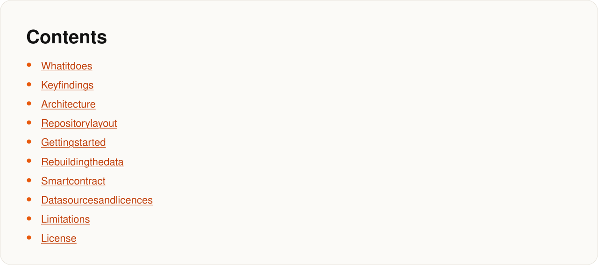</p>
<p align="center"><sub><a href="#what-it-does">What it does</a> · <a href="#key-findings">Key findings</a> · <a href="#architecture">Architecture</a> · <a href="#repository-layout">Repository layout</a> · <a href="#getting-started">Getting started</a> · <a href="#rebuilding-the-data">Rebuilding the data</a> · <a href="#smart-contract">Smart contract</a> · <a href="#data-sources-and-licences">Data sources and licences</a> · <a href="#limitations">Limitations</a> · <a href="#license">License</a></sub></p>

<a id="what-it-does"></a>
<p align="center"></p>

<p align="center"></p>

<p align="center"></p>

<a id="ai-and-live-features"></a>
<p align="center"></p>

<a id="key-findings"></a>
<p align="center">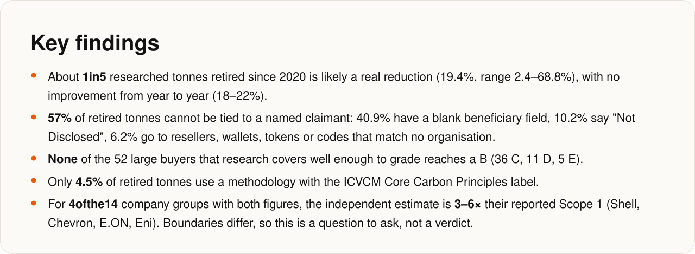</p>

<p align="center"></p>

<a id="architecture"></a>
<p align="center">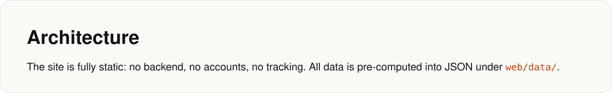</p>

<p align="center">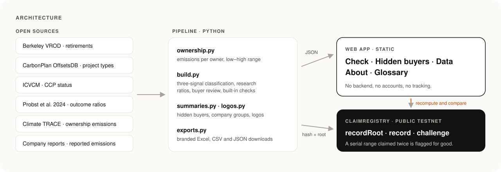</p>

<a id="repository-layout"></a>
<p align="center">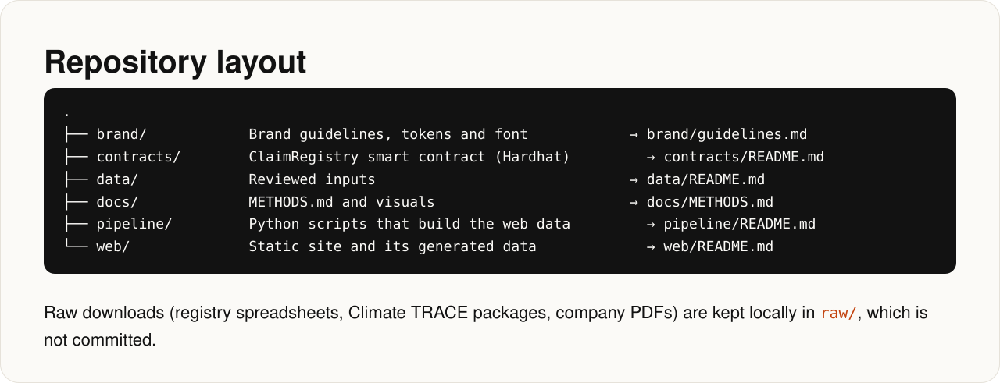</p>
<details><summary>Copy the commands</summary>

```bash
.
├── brand/            Brand guidelines, tokens and font            → brand/guidelines.md
├── contracts/        ClaimRegistry smart contract (Hardhat)         → contracts/README.md
├── data/             Reviewed inputs                              → data/README.md
├── docs/             METHODS.md and visuals                       → docs/METHODS.md
├── pipeline/         Python scripts that build the web data         → pipeline/README.md
└── web/              Static site and its generated data             → web/README.md
```

</details>

<p align="center">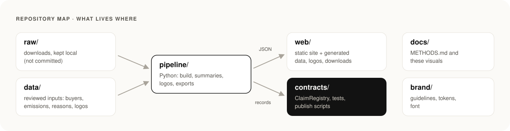</p>

<a id="getting-started"></a>
<p align="center">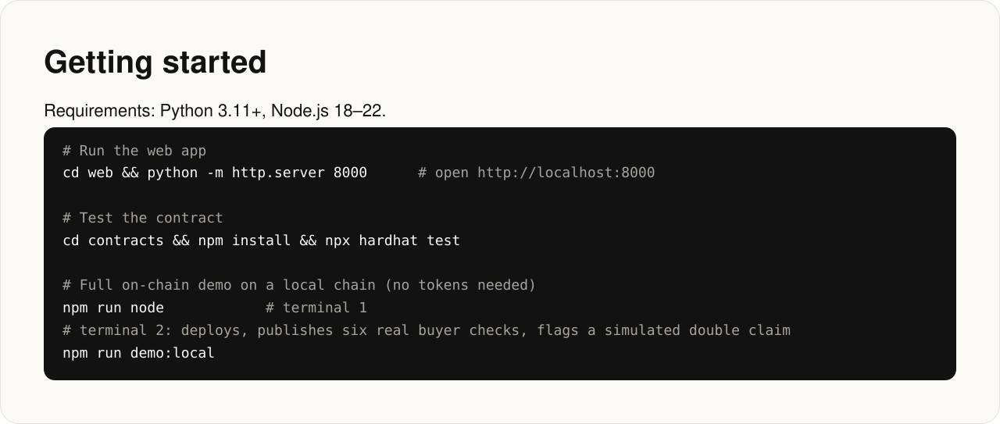</p>
<details><summary>Copy the commands</summary>

```bash
# Run the web app
cd web && python -m http.server 8000      # open http://localhost:8000

# Test the contract
cd contracts && npm install && npx hardhat test

# Full on-chain demo on a local chain (no tokens needed)
npm run node            # terminal 1
npm run demo:local      # terminal 2: deploys, publishes six real buyer checks, flags a simulated double claim
```

</details>

<a id="rebuilding-the-data"></a>
<p align="center">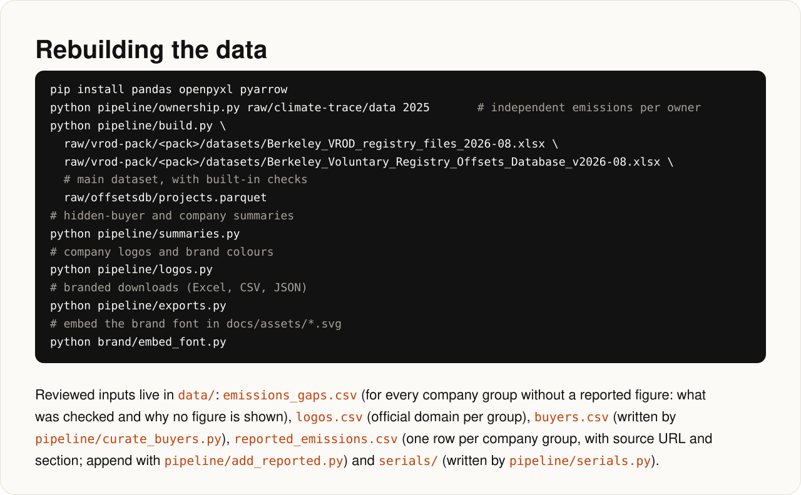</p>
<details><summary>Copy the commands</summary>

```bash
pip install pandas openpyxl pyarrow
python pipeline/ownership.py raw/climate-trace/data 2025       # independent emissions per owner
python pipeline/build.py \
  raw/vrod-pack/<pack>/datasets/Berkeley_VROD_registry_files_2026-08.xlsx \
  raw/vrod-pack/<pack>/datasets/Berkeley_Voluntary_Registry_Offsets_Database_v2026-08.xlsx \
  raw/offsetsdb/projects.parquet                                # main dataset, with built-in checks
python pipeline/summaries.py                                    # hidden-buyer and company summaries
python pipeline/logos.py                                        # company logos and brand colours
python pipeline/exports.py                                      # branded downloads (Excel, CSV, JSON)
python brand/embed_font.py                                      # embed the brand font in docs/assets/*.svg
```

</details>

<a id="smart-contract"></a>
<p align="center"></p>
<details><summary>Copy the commands</summary>

```bash
npm run demo:sepolia        # publish to Ethereum Sepolia (needs PRIVATE_KEY in .env and test ETH)
npm run demo:base-sepolia   # alternative public testnet
```

</details>

<p align="center">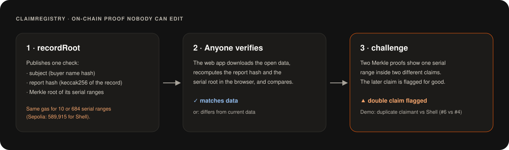</p>

<a id="data-sources-and-licences"></a>
<p align="center">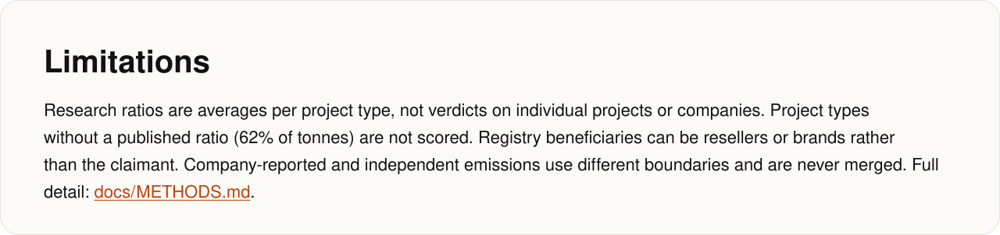</p>

<a id="limitations"></a>
<p align="center">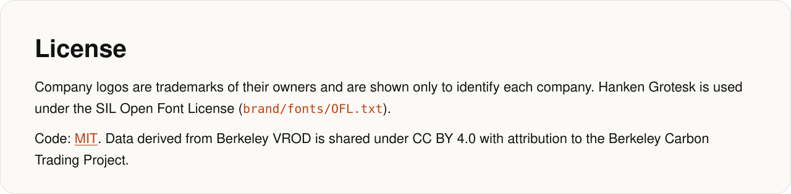</p>
<p align="center"><sub><a href="docs/METHODS.md">docs/METHODS.md</a></sub></p>

<a id="roadmap"></a>
<p align="center">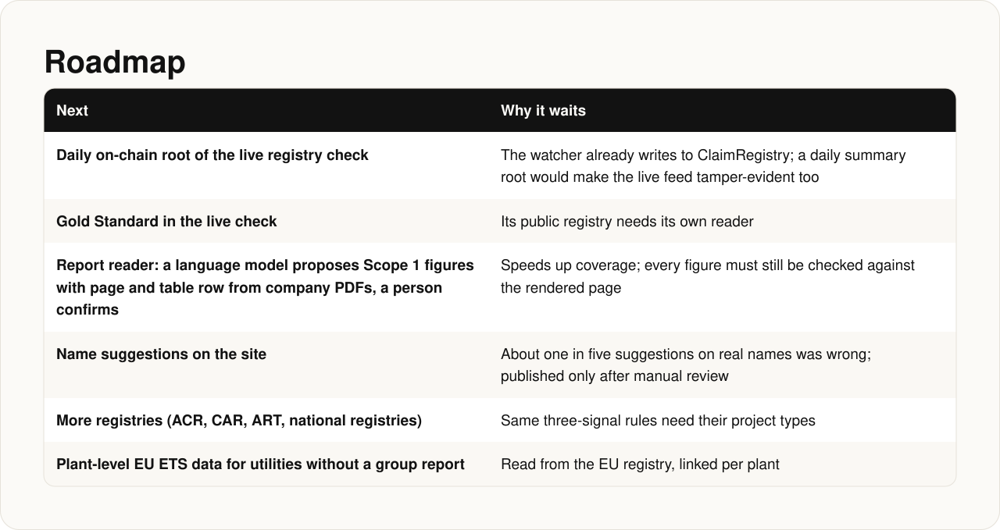</p>

<a id="license"></a>
<p align="center"></p>
<p align="center"><sub><a href="LICENSE">MIT</a></sub></p>
