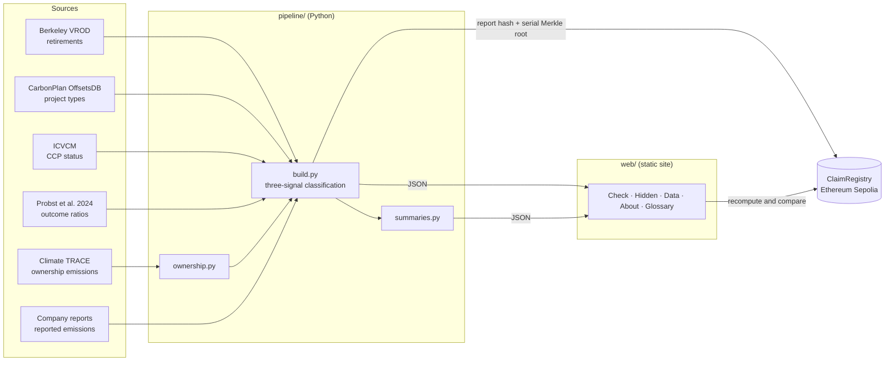

<p align="center"></p>

<h1 align="center">Netra</h1>

<p align="center"><b>See what a carbon claim is really worth.</b><br>
Carbon credits retired by companies, checked against peer-reviewed research, the company's own emissions report and an independent estimate, with every check recorded on a public blockchain.</p>

<p align="center">IEEE ClimateChain Global Hackathon 2026 · Track 1: Carbon Markets &amp; Emissions Transparency</p>

---

## Contents

- [What it does](#what-it-does)
- [Key findings](#key-findings)
- [Architecture](#architecture)
- [Repository layout](#repository-layout)
- [Getting started](#getting-started)
- [Rebuilding the data](#rebuilding-the-data)
- [Smart contract](#smart-contract)
- [Data sources and licences](#data-sources-and-licences)
- [Limitations](#limitations)
- [License](#license)

## What it does

| Question | How Netra answers it |
|---|---|
| What did a company retire? | Every Verra and Gold Standard retirement since 2020 (342,012 records, 876 Mt), grouped by the beneficiary and, for the largest buyers, by company group. |
| How much of it is likely real? | Tonnes × the share of real reductions that research found for that project type (Probst et al. 2024), with the published range and a grade from A to E. |
| What does the company emit? | Its own reported figure, read from its primary report (76 company groups, 93.7% of company tonnes), next to Climate TRACE's independent ownership-weighted estimate. |
| Who is hiding? | Anonymous, "Not Disclosed", reseller, wallet and untraceable accounts, labelled and quantified. |
| Can the check be trusted later? | A hash of each published check and a Merkle root of its registry serial ranges are written to the `ClaimRegistry` contract. A serial range claimed twice can be flagged on-chain by anyone. |

The web app has five views: **Check** (search and company result), **Hidden buyers**, **Data** (all company groups, sortable, with side-by-side comparison and downloads), **About** (story, research, sources, limits) and **Glossary** (every term in plain English).

## Key findings

- About **1 in 5** researched tonnes retired since 2020 is likely a real reduction (19.4%, range 2.4–68.8%), with no improvement from year to year (18–22%).
- **57%** of retired tonnes cannot be tied to a named claimant; 40.9% have no beneficiary at all.
- Only **4.5%** of retired tonnes use a methodology with the ICVCM Core Carbon Principles label.
- Company-reported and independent emissions differ by a factor of **2–3** for large emitters.

## Architecture



The site is fully static: no backend, no accounts, no tracking. All data is pre-computed into JSON under `web/data/`.

## Repository layout

```
.
├── brand/            Brand guidelines and design tokens
├── contracts/        ClaimRegistry smart contract (Hardhat): source, tests, deploy and publish scripts
├── data/             Curated, reviewed inputs: buyer classification, reported emissions, ICVCM status, serial ranges
├── docs/             METHODS.md: every rule, source, validation step and limit
├── pipeline/         Python scripts that build the web data from the raw sources
└── web/              Static web app (HTML, CSS, vanilla JavaScript) and its generated data
```

Raw downloads (registry spreadsheets, Climate TRACE packages, company PDFs) are kept locally in `raw/`, which is not committed.

## Getting started

Requirements: Python 3.11+, Node.js 18–22.

```bash
# Run the web app
cd web && python -m http.server 8000      # open http://localhost:8000

# Test the contract
cd contracts && npm install && npx hardhat test

# Full on-chain demo on a local chain (no tokens needed)
npm run node            # terminal 1
npm run demo:local      # terminal 2: deploys, publishes six real buyer checks, flags a simulated double claim
```

## Rebuilding the data

```bash
pip install pandas openpyxl pyarrow
python pipeline/ownership.py raw/climate-trace/data 2025       # independent emissions per owner
python pipeline/build.py \
  raw/vrod-pack/<pack>/datasets/Berkeley_VROD_registry_files_2026-08.xlsx \
  raw/vrod-pack/<pack>/datasets/Berkeley_Voluntary_Registry_Offsets_Database_v2026-08.xlsx \
  raw/offsetsdb/projects.parquet                                # main dataset, with built-in checks
python pipeline/summaries.py                                    # hidden-buyer and company summaries
```

Reviewed inputs live in `data/`: `buyers.csv` (written by `pipeline/curate_buyers.py`), `reported_emissions.csv` (one row per company group, with source URL and section; append with `pipeline/add_reported.py`) and `serials/` (written by `pipeline/serials.py`).

## Smart contract

`contracts/src/ClaimRegistry.sol` (Solidity 0.8.24, OpenZeppelin MerkleProof):

| Function | Purpose |
|---|---|
| `recordRoot` | Publish a check: subject, report hash, report URI and the Merkle root of its serial-range nullifiers. Constant gas (~149k) regardless of serial count. |
| `record` | Publish a check with explicit nullifiers; rejects any nullifier already claimed. |
| `challenge` | Prove with two Merkle proofs that one serial range backs two checks; the later check is flagged permanently. |

```bash
npm run demo:sepolia        # publish to Ethereum Sepolia (needs PRIVATE_KEY in .env and test ETH)
npm run demo:base-sepolia   # alternative public testnet
```

Network settings live in `contracts/scripts/chains.js`; the web app reads the active deployment from `web/data/deployment.json`.

## Data sources and licences

| Source | Use | Licence or version |
|---|---|---|
| Berkeley Carbon Trading Project, Voluntary Registry Offsets Database | Retirements, project types | v2026-08, CC BY 4.0 |
| CarbonPlan OffsetsDB | Second project-type signal | 2026 snapshot |
| ICVCM assessment status | CCP labels per methodology | Snapshot 18 Aug 2026 |
| Probst et al. 2024, *Nature Communications*, doi:10.1038/s41467-024-53645-z | Outcome achievement ratios and ranges | Published supplementary data |
| Climate TRACE | Independent emissions by owner | v5.7.0, 2025 |
| Company annual and sustainability reports | Reported emissions | Linked per row in `data/reported_emissions.csv` |

## Limitations

Research ratios are averages per project type, not verdicts on individual projects or companies. Project types without a published ratio (62% of tonnes) are not scored. Registry beneficiaries can be resellers or brands rather than the claimant. Company-reported and independent emissions use different boundaries and are never merged. Full detail: [docs/METHODS.md](docs/METHODS.md).

## License

Code: [MIT](LICENSE). Data derived from Berkeley VROD is shared under CC BY 4.0 with attribution to the Berkeley Carbon Trading Project.
