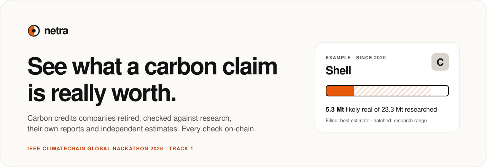
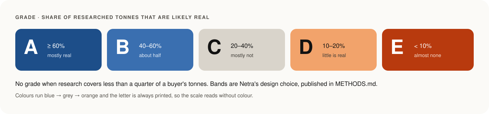

# Netra brand guidelines (v0.1)

Format follows [cofoundy/brand-skills](https://github.com/cofoundy/brand-skills): context, positioning, identity, voice, messaging. Visual board: see `brand.yaml`.

## Context
- **What:** Netra grades the carbon credits a company says it retired. Registry data, published research, the company's own report and an independent emissions estimate, side by side. Each check is recorded on a public blockchain.
- **For:** the public and journalists (is this claim real?), scientists (open data and method), buyers and auditors (due diligence), regulators (EU Directive 2024/825 on green claims).
- **Name:** *netra* is Sanskrit for "eye", also known in Indonesian. Short, easy to say worldwide.

## Positioning
- Sylvera, BeZero and Calyx grade carbon **projects**, behind paywalls. CarbonPlan publishes open research but does not grade companies. Climate TRACE estimates emissions only.
- **Netra grades the claim a company makes**, free, with every source linked and every check on the record.
- Proof points: 876 Mt retired since 2020 checked; 44,465 buyers; primary-source emissions for 79 of 94 classified company groups (94.3% of company tonnes).

## Identity
- **Mark:** an eye whose iris is half filled with the signal colour: the share of a claim that holds up. Always with the lowercase wordmark `netra` (Hanken Grotesk 600, tracking −0.04em). Mark alone for favicon and app icon.
- **Colour:** ink `#121212`, paper `#FBFAF7`, one signal `#E8590C`, line `#E6E2DA`. No green (the colour of greenwashing). Dark sections are reserved for proof (on-chain record).

- **Grades:** A `#1D4E89`, B `#3A6FB0`, C `#D9D4CB`, D `#F2A36B`, E `#B83A0E`. Blue to orange, readable with colour blindness; the letter is always printed on the swatch.
- **Type:** Hanken Grotesk for everything (headlines 600, body 400, labels 600 caps with +0.08em tracking, tabular numbers). Fragment Mono only for hashes and serial numbers.
- **Signature device:** the claimed-vs-real bar. Outline = claimed, hatched = research range, filled = best estimate. Use it wherever a claim is shown.
- **Layout:** centred hero with one search box, generous white space, cards with 16 px radius and 1 px line borders. One action per screen.

## Voice
- Blunt, factual, calm. Short sentences. Every claim carries a number and a source.
- No outrage words ("scam", "fraud", "shocking"). The data does the talking.
- We write: "Shell retired 42.3 Mt of credits since 2020. Research covers 23.3 Mt of them. About 5.3 Mt are likely real. Range: 0.3 to 19.9 Mt. Sources below."
- We never write: "Shell's shocking offset scam exposed!"
- The method line is stated as fact, not apology: "Estimates from published research (Probst et al. 2024) applied to registry data. Every number links to its source. Check them."

## Messaging
- **Tagline:** See what a carbon claim is really worth.
- **Value line:** Type a company. See the credits it retired, how many research says are likely real, what it reports emitting, and what independent estimates see.
- **Headline facts:** about 1 in 5 researched tonnes likely real (19.4%, range 2.4–68.8%, flat since 2020); 40% of tonnes name no buyer; 4.5% carry the ICVCM quality label; reported and independent emissions differ 2–3×.
- **Proof line:** Every check is on the record. Nobody can edit it later.
