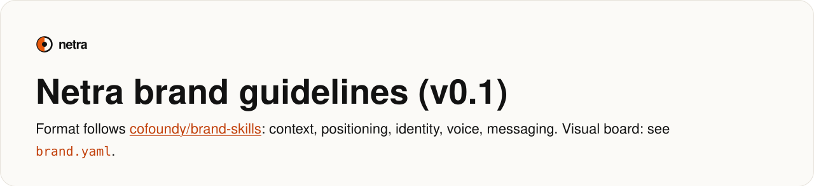
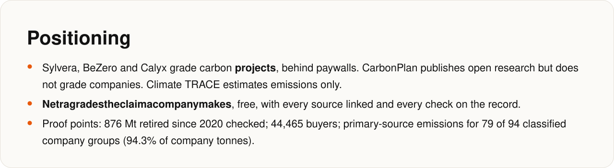
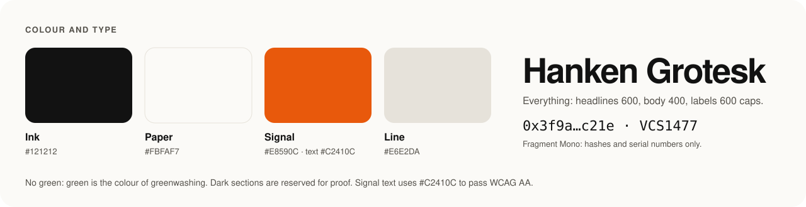

<!-- Generated by docs/render.py from docs/src/brand-guidelines.md. Edit the source, then run: python docs/render.py -->

<a href="https://github.com/cofoundy/brand-skills">cofoundy/brand-skills</a>

