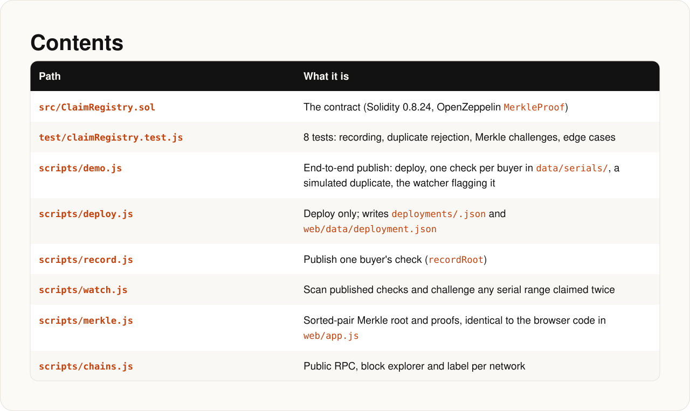
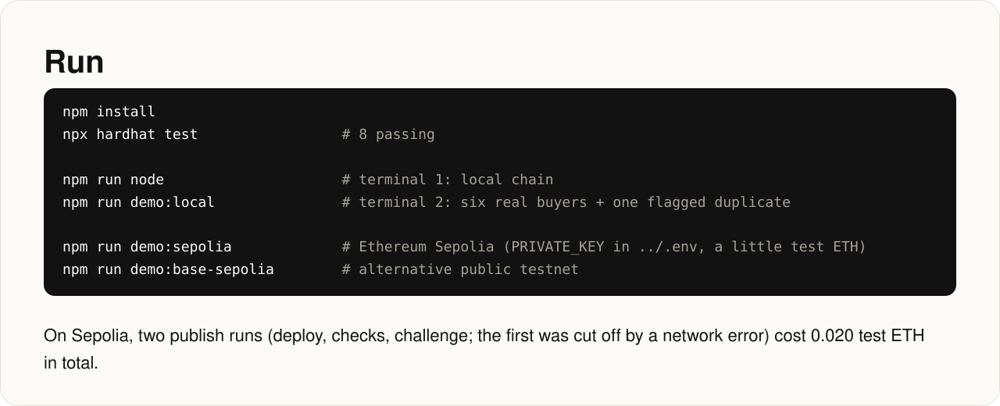
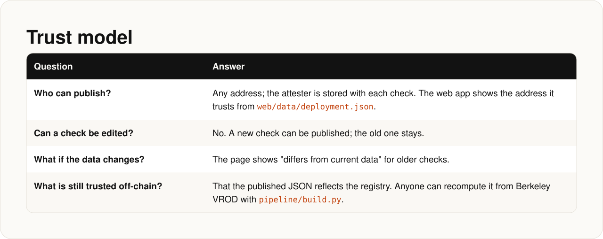

<!-- Generated by docs/render.py from docs/src/contracts.md. Edit the source, then run: python docs/render.py -->

<p align="center"></p>

<a id="contracts-claimregistry"></a>
<p align="center"></p>

<a id="contents"></a>
<p align="center"></p>

<a id="functions"></a>
<p align="center"></p>

<a id="run"></a>
<p align="center"></p>
<details><summary>Copy the commands</summary>

```bash
npm install
npx hardhat test                 # 8 passing

npm run node                     # terminal 1: local chain
npm run demo:local               # terminal 2: six real buyers + one flagged duplicate

npm run demo:sepolia             # Ethereum Sepolia (PRIVATE_KEY in ../.env, a little test ETH)
npm run demo:base-sepolia        # alternative public testnet
```

</details>

<a id="trust-model"></a>
<p align="center"></p>
