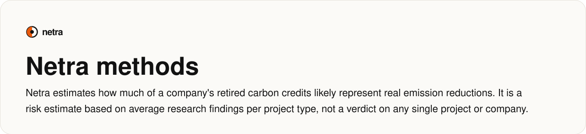
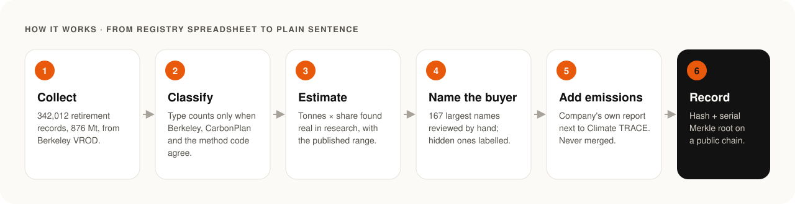
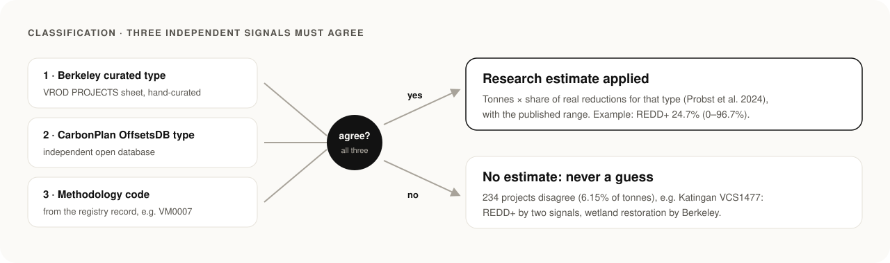
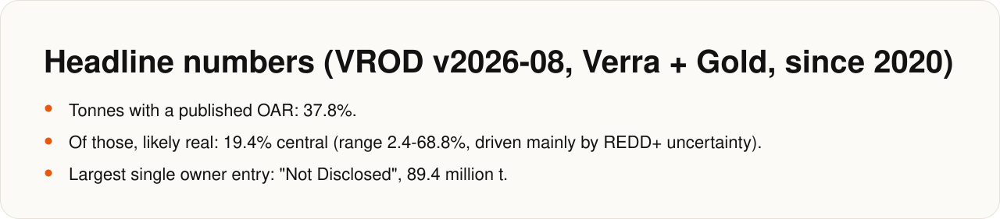
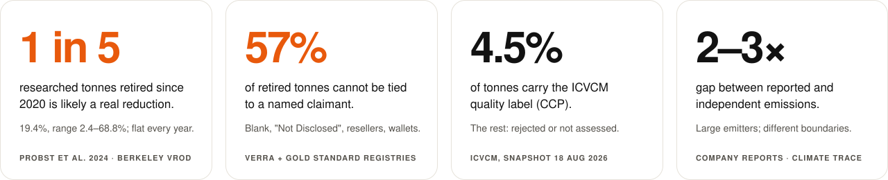
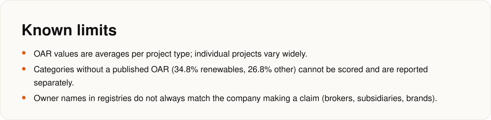
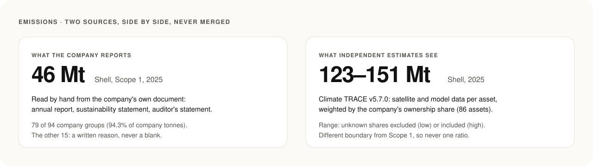
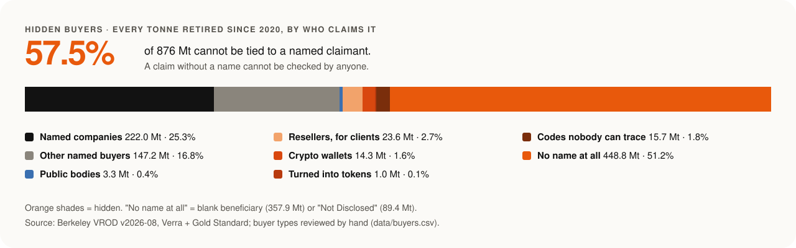

<!-- Generated by docs/render.py from docs/src/METHODS.md. Edit the source, then run: python docs/render.py -->

<a href="https://www.shell.com/investors/results-and-reporting/annual-report.html">Shell plc Annual Report and Accounts 2025</a> · <a href="https://report.eni.com/annual-report-2025/en/_assets/downloads/sustainability-eni-ar25.pdf">Eni Annual Report 2025 Sustainability Statement</a> · <a href="https://www.chevron.com/-/media/chevron/sustainability/documents/ghg-assurance.pdf">DNV assurance statement on Chevron 2025 GHG data (DNV-2026-ASR-863200-1)</a> · <a href="https://annualreport2025.volkswagen-group.com/sustainability-report/environmental-information/climate-change.html">Volkswagen Group Annual Report 2025 - Climate change</a> · <a href="https://esghub.delta.com/content/esg/en/2025/ghg-emissions-data.html">2025 Delta Difference Report - GHG Emissions Data</a> · <a href="https://s203.q4cdn.com/522538739/files/doc_governance/2026/03/49677_easyjet_factsheet_Enviro_Disclosure_AW.pdf">easyJet plc Environmental Disclosures ESG Factsheet (FY2025)</a> · <a href="https://s22.q4cdn.com/959853165/files/doc_downloads/2026/6/2025-Netflix-Environmental-Social-Governance-Report.pdf">2025 Netflix Environmental Social Governance Report</a> · <a href="https://www.holcim.com/sites/holcim/files/docs/27022026-holcim-sustainability-statement-2025.pdf">Holcim 2025 Sustainability Statement</a> · <a href="https://www.engie.com/app/uploads/2026/02/2025-04-23-ENGIE-SASB-Disclosure-2024-2023-2022.pdf">ENGIE SASB Disclosure 2024-2023-2022</a> · <a href="https://www.petrochina.com.cn/ptr/gsgg/202503/c7f46bff3c8548ecad122a1626d64831/files/cd0d49615ba241ea81c20860434cee66.pdf">PetroChina 2024 Environmental, Social and Governance Report</a> · <a href="https://www.cpc.com.tw/en/cp.aspx?n=4278">CPC Corporation, Taiwan - Energy Conservation &amp; Carbon Reduction</a> · <a href="https://www.boeing.com/content/dam/boeing/v2/company/sustainability/documents/ghg_emissions_assurance_statement.pdf">DNV assurance statement on Boeing GHG emissions (DNV-2026-ASR-871413-1)</a> · <a href="https://assets-dam.takeda.com/image/upload/v1743433700/LOC/en-gb/Corporate_Responsibility/Sustainability/TUK_CRP_2025.pdf">Takeda UK Carbon Reduction Plan 2025 (global FY23 emissions)</a> · <a href="https://www.yamato-hd.co.jp/english/investors/library/annualreport/pdf/e_ir2025_07_01.pdf">Yamato Holdings Integrated Report 2025 (non-financial highlights)</a> · <a href="https://www.geopost.com/en/news/geopost-s-2025-annual-results/">Geopost 2025 annual results</a> · <a href="https://www.woodside.com/sustainability/environment/climate/Scope-1-and-2-ghg-emissions">Woodside - Scope 1 and 2 GHG emissions</a> · <a href="https://www.apple.com/environment/pdf/Apple_Environmental_Progress_Report_2026.pdf">Apple Environmental Progress Report 2026</a> · <a href="https://www.bayer.com/sites/default/files/2026-03/bayer-sfdr-index-2025.pdf">Bayer SFDR Index 2025 (refers to Annual Report 2025 p. 151)</a> · <a href="https://www.salesforce.com/en-us/wp-content/uploads/sites/4/documents/white-papers/fy25-schedules-of-environmental-and-employee-metrics.pdf">Salesforce FY25 Schedules of Environmental and Employee Metrics</a> · <a href="https://s205.q4cdn.com/354928249/files/doc_downloads/esg-resources/2026/Interface-GHG-Verification-Statement-CY2025.pdf">Interface GHG Verification Statement CY2025 (WAP Sustainability)</a> · <a href="https://www.lufthansagroup.com/media/downloads/en/responsibility/LHG-SASB-Report-2025.pdf">Lufthansa Group SASB Report 2025</a> · <a href="https://www.daigasgroup.com/en/files/data/sustainability/reportpolicy/integrated_report/report2025_81.pdf">Daigas Group Integrated Report 2025</a> · <a href="https://group.vattenfall.com/globalassets/com/sustainability/net-zero-assessment-vattenfall-ab-04-jun-2026.pdf">Vattenfall AB net-zero assessment (June 2026)</a> · <a href="https://assets.kuehne-nagel.com/f/331466/x/a7fc2ff421/company-sustainability-esg-sustainability-report-2025.pdf">Kuehne+Nagel Sustainability Report 2025</a> · <a href="https://corporate.zalando.com/sites/default/files/media-download/2025_11-zalando-se-cdp-climate-change-and-water-security-questionnaire.pdf">Zalando SE CDP Climate Change Questionnaire 2025</a> · <a href="https://www.vistajet.com/globalassets/documents/vistajet-2020-ghg-accounting-report.pdf">VistaJet Greenhouse gas (GHG) accounting report 2020</a> · <a href="https://www.telstra.com.au/content/dam/tcom/about-us/community-environment/pdf/2026-telstra-bigger-picture-report-data-pack.xlsx">Telstra Bigger Picture Report 2026 Data Pack</a> · <a href="https://d1io3yog0oux5.cloudfront.net/_a1acaca7421666bca2f98a96c1a04fee/nclhltd/db/1204/11729/file/2025+NCLH+Sail+%26+Sustain+Technical+Appendix.pdf">2025 NCLH Sail &amp; Sustain Technical Appendix</a> · <a href="https://cdn-dynmedia-1.microsoft.com/is/content/microsoftcorp/microsoft/msc/documents/presentations/CSR/2025-Microsoft-Environmental-Data-Fact-Sheet-PDF.pdf">2025 Microsoft Environmental Data Fact Sheet</a> · <a href="https://investors.etsy.com/_assets/_fea57334fe81a735b34cf3bf4bdcb553/etsy/db/938/10062/report_of_independent_accountants/PwC+Report+%28signed%29+%2B+Mgt+Assertion+2.19.26.pdf">Etsy management assertion and PwC report on 2025 GHG metrics</a> · <a href="https://s205.q4cdn.com/179588156/files/doc_downloads/2026/06/Grab-ESG-Report-2025.pdf">Grab ESG Report 2025</a> · <a href="https://www.churchdwight.com/pdf/Sustainability/2025-Sustainability-Report.pdf">Church &amp; Dwight 2025 Sustainability Report</a> · <a href="https://announcements.asx.com.au/asxpdf/20250905/pdf/06nw0dw9w0xvsq.pdf">Qantas Group Sustainability Report 2025 (ASX release)</a> · <a href="https://www.ey.com/content/dam/ey-unified-site/ey-com/en-gl/campaigns/value-realized/documents/2025/ey-value-realized-report-2025.pdf">EY Value Realized 2025</a> · <a href="https://impact.disney.com/resources/emissions-verification-2025/">Disney Emissions Verification Statement (2025)</a> · <a href="https://reports.beiersdorf.com/annual-report/2025/combined-management-report/non-financial-statement/environmental-information/e1-climate-change.html">Beiersdorf Annual Report 2025, E1 Climate change</a> · <a href="https://www.barillagroup.com/media/filer_public/c3/5e/c35e76fb-8f41-4b30-88c2-0a783f233517/barilla_group_sustainabilityreport_2025.pdf">Barilla Group Sustainability Report 2025</a> · <a href="https://www.nestle.com/sites/default/files/2026-02/non-financial-statement-2025.pdf">Nestlé Non-Financial Statement 2025</a> · <a href="https://www.2025datacentre.agl.com.au/environment/greenhouse-energy/operational-greenhouse-gas-footprint-and-net-energy-production">AGL ESG Data Centre FY25 - Operational greenhouse gas footprint</a> · <a href="https://www.originenergy.com.au/wp-content/uploads/45/Origin_2025_Sustainability_Report.pdf">Origin Energy 2025 Sustainability Report and performance data</a> · <a href="https://www.jal.com/sites/en/sustainability/environment/environment-management/pdf_sites/en_CO2_JAL_verification_statements.pdf">JAL Independent Verification Statement (GHG Ref. 884G)</a> · <a href="https://www.bookingholdings.com/wp-content/uploads/2026/04/Booking-Holdings_2025-Sustainability-Report.pdf">Booking Holdings 2025 Sustainability Report</a> · <a href="https://www.mapleleaffoods.com/wp-content/uploads/sites/6/2026/06/2026-06-18-MLF-ESG-AR.pdf">KPMG assurance report on Maple Leaf Foods 2025 ESG metrics</a> · <a href="https://www.jet2plc.com/-/media/jet2/jet2plc/pdfs/09-08-24/jet2-plc-annual-report-2024.pdf">Jet2 plc Annual Report &amp; Accounts 2024</a> · <a href="https://www.rei.com/dam/25475257_rei-2025-ghg-verification-statement-03.23.26.pdf">REI 2025 GHG verification statement</a> · <a href="https://www.anz.com.au/content/dam/anzcomau/about-us/2025%20GHG%20and%20Offsets%20Assurance%20Opinion%20Report.pdf">ANZ 2025 GHG and Offsets Assurance Report (KPMG)</a> · <a href="https://www.pwc.com/gx/en/about/corporate-sustainability/environmental-stewardship.html">PwC - Environmental stewardship</a> · <a href="https://annualreport.eon.com/content/dam/eon-annualreport/documents/en/GB24-gesamt-EN_final.pdf">E.ON Integrated Annual Report 2024</a> · <a href="https://www.lapostegroupe.com/assets/media/le-groupe-laposte/ajUVto1P9HI4UuNm_Cahier_des_indicateurs_ESG_2025_EN_VMEL.pdf">La Poste Groupe GRI Index - ESRS 2025 ESG Metrics</a> · <a href="https://www.chanel.com/puls-img/1784902811893-chanel-climate-transition-plan-fy25.pdf">Chanel Climate Transition Plan FY25 Update</a> · <a href="https://www.catl.com/en/uploads/1/file/public/202409/20240920152219_4mm2h2equv.pdf">CATL Carbon Accounting Report 2023</a> · <a href="https://www.tokyo-gas.co.jp/en/IR/library/pdf/anual/25e07.pdf">Tokyo Gas Group Integrated Report 2025</a> · <a href="https://www.tohogas.co.jp/lang/en/approach/eco/eco-10/pdf/2025_en_sustainability_factbook.pdf">Toho Gas Group Sustainability Factbook 2025</a> · <a href="https://www.ovako.com/en/sustainability/environment/carbon-offset/">Ovako - Carbon offsetting</a> · <a href="https://www.remy-cointreau.com/app/uploads/2025/06/Universal-Registration-Document-2024-25.pdf">Rémy Cointreau Universal Registration Document 2024-25</a> · <a href="https://edge.sitecorecloud.io/fortescue17114-fortescueeb60-productionbbdb-8be5/media/project/fortescueportal/shared/documents/reporting/100-ds-gn-0003-fy25-esg-databook-rev5.xlsx">Fortescue FY25 ESG Databook</a> · <a href="https://www.entega.ag/fileadmin/downloads/nachhaltigkeit/Nachhaltigkeitsbericht_2025_WEB.pdf">ENTEGA Nachhaltigkeitsbericht 2025</a> · <a href="https://group.nedbank.co.za/content/dam/group/pdf/21_integrated-reports/2024/climate-reporting/2024-climate-report-nedbank.pdf">Nedbank Group 2024 Climate Report</a> · <a href="https://gruppe.schwarz/en/asset/download/10701/file/CompaniesOfSchwarzGroup_FY22_KeyFiguresEcosystems.pdf?version=4">Companies of Schwarz Group FY22 Key Figures Ecosystems</a> · <a href="https://www.lavazzagroup.com/content/dam/lavazza/sostenibilit%C3%A0/aggiornamento-maggio-26/260520_Lavazza_BdS2025_ENG_interactive.pdf">Lavazza Group Sustainability Report 2025</a> · <a href="https://live.euronext.com/sites/default/files/esg_document_files/2026-07/003011_02%20-%20Universal%20Registration%20Document%202025_EN_2026-07-02_12:50.pdf">Kering 2025 Universal Registration Document</a> · <a href="https://content.presspage.com/uploads/3167/ddc6714f-ffcc-4d61-a382-ee84d8a6fb45/2025_csr_en.pdf">Air Canada 2025 Corporate Sustainability Report (Citizens of the World)</a> · <a href="https://www.allianz.com/content/dam/onemarketing/azcom/Allianz_com/investor-relations/en/results-reports/annual-report/ar-2025/en-allianz-group-annual-report-2025.pdf">Allianz Group Annual Report 2025 (Sustainability Statement)</a> · <a href="https://www.bat.com/content/dam/batcom/global/main-nav/investors-and-reporting/reporting/sustainability-reporting/BAT_Sustainability_Performance_Data_Book_2025.pdf">BAT Sustainability Performance Data Book 2025</a> · <a href="https://www.airfranceklm.com/sites/default/files/2025-04/2024_urd_ven_04032025.pdf">Air France-KLM 2024 Universal Registration Document</a> · <a href="https://www.infosys.com/sustainability/documents/carbon-neutrality/carbon-neutrality-declaration2026.pdf">Infosys Carbon Neutrality Declaration 2026 (ISO 14068)</a> · <a href="https://www.cevalogistics.com/documents/2025-03/2024%20CSR%20Report%20CMA%20CGM%20Group.pdf">CMA CGM Group 2024 CSR Report (Non-Financial Performance Report), copy hosted by group subsidiary CEVA Logistics</a> · <a href="https://filemanager-cdn.mziq.com/published/9e61d5ff-4641-4ec3-97a5-3595f938bb75/a27854da-40b3-4890-87c6-5bc397d8c2cf">Natura Sustainability-Related Financial Information Report 2025 (IFRS S1 and S2)</a> · <a href="https://www.energyaustralia.com.au/sites/default/files/2026-03/EA_ASRS%20Report%20-%20FY25.pdf">EnergyAustralia Climate-related Financial Disclosure (ASRS) Report FY25</a> · <a href="https://www.arvedi.it/fileadmin/user_upload/2026/Finarvedi_SPA_Bilancio_Consolidato_2025.pdf">Finarvedi S.p.A. Bilancio Consolidato 2025 (Sustainability Statement, voluntary CSRD)</a> · <a href="https://find-and-update.company-information.service.gov.uk/company/08862063/filing-history/MzU0NjAyODE0NGFkaXF6a2N4/document?format=pdf&download=0">Energy Transition Holdings Ltd Annual Report and Financial Statements 2025 (filed at Companies House under Energy Transition Group Ltd, 08862063)</a> · <a href="https://find-and-update.company-information.service.gov.uk/company/SC311560/filing-history/MzQ4MzI3MDk5MmFkaXF6a2N4/document?format=pdf&download=0">BrewDog PLC Full Accounts for year ended 31 December 2024 (Companies House SC311560), Strategic report SECR</a> · <a href="https://investor.aeciworld.com/pdf/integrated-reports/2025/2025-sustainability-report.pdf">AECI Sustainability Report 2025</a> · <a href="https://s27.q4cdn.com/263799617/files/doc_downloads/2025/09/Lyft-2024-Sustainability-Impact-Report.pdf">Lyft 2024 Sustainability Impact Report</a> · <a href="https://www.chiesi.com/content/dam/chiesi-corporate/global/en/archive/document-archive/2026/esg_reports_2025.pdf.coredownload.pdf">Chiesi ESG Reports 2025 (TCFD Report 2025)</a> · <a href="https://shawinc.com/2025sustainabilityreport">Shaw Industries 2025 Corporate Sustainability Report</a> · <a href="https://www.suewag.com/corp/ueber-uns/finanzen/zahlen-daten-fakten/geschaeftsbericht">Süwag Geschäftsbericht 2025, key figures (Kennzahlen, Nachhaltigkeit)</a> · <a href="https://scharr.de/fileadmin/media/KG/Dateien/Nachhaltigkeit/SCHARR-KLIMAWIN-Nachhaltigkeitsbericht-2023.pdf">SCHARR KLIMAWIN report 2023</a> · <a href="https://www.kvvks.de/fileadmin/kvvks/Dokumente/Geschaeftsberichte/2022/2023_01_Kassel__KVV_Nachhaltigkeitsbericht_DS.pdf">KVV Kassel sustainability report 2022</a>

