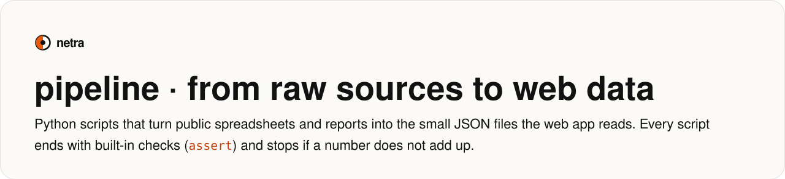
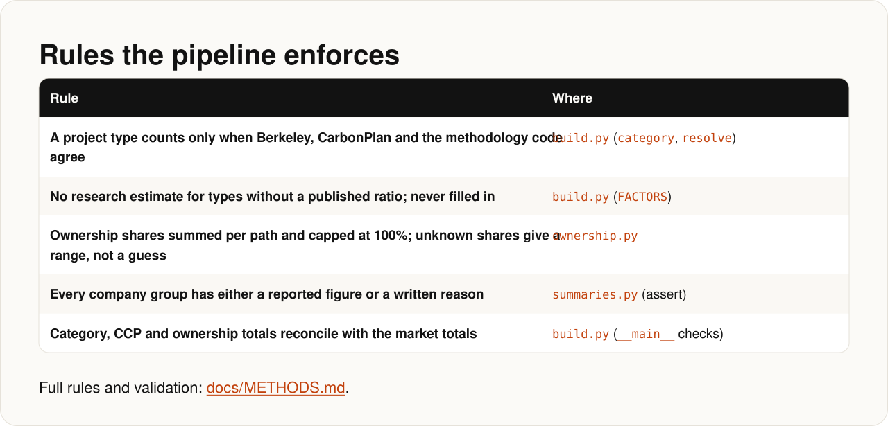

<!-- Generated by docs/render.py from docs/src/pipeline.md. Edit the source, then run: python docs/render.py -->

<p align="center"></p>

<a id="pipeline-from-raw-sources-to-web-data"></a>
<p align="center"></p>

<p align="center"></p>

<a id="order-to-run"></a>
<p align="center"></p>
<details><summary>Copy the commands</summary>

```bash
pip install pandas openpyxl pyarrow pillow
```

</details>

<a id="rules-the-pipeline-enforces"></a>
<p align="center"></p>
<p align="center"><sub><a href="../docs/METHODS.md">docs/METHODS.md</a></sub></p>
