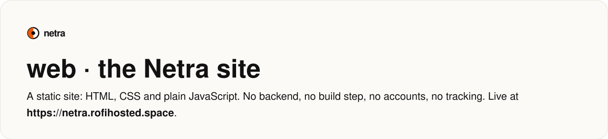
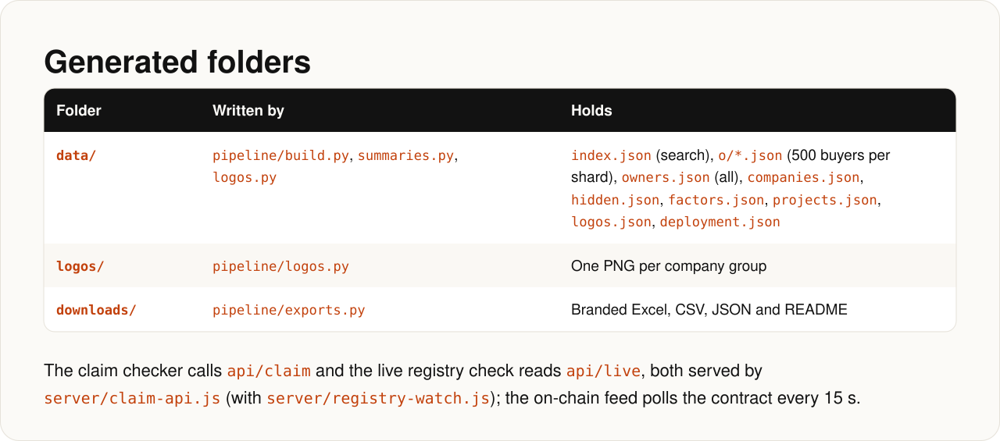
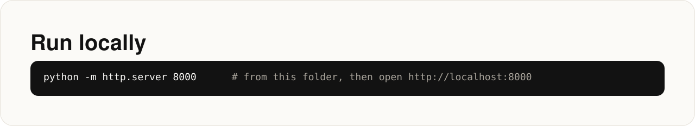
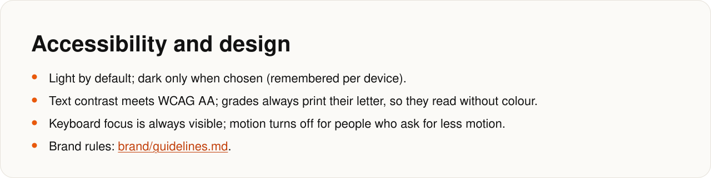

<!-- Generated by docs/render.py from docs/src/web.md. Edit the source, then run: python docs/render.py -->

<p align="center"></p>

<a id="web-the-netra-site"></a>
<p align="center"></p>

<a id="pages"></a>
<p align="center"></p>

<a id="generated-folders"></a>
<p align="center"></p>

<a id="run-locally"></a>
<p align="center"></p>
<details><summary>Copy the commands</summary>

```bash
python -m http.server 8000      # from this folder, then open http://localhost:8000
```

</details>

<a id="accessibility-and-design"></a>
<p align="center"></p>
<p align="center"><sub><a href="../brand/guidelines.md">brand/guidelines.md</a></sub></p>
